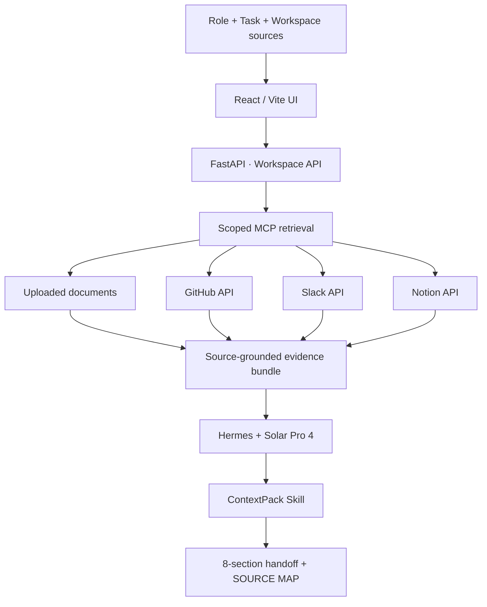

<div align="center">

# 🧩 ContextPack

### Task-conditioned Context Handoff Agent

**The right context, for the next task.**  
GitHub·Slack·Notion·업로드 문서에서 지금 필요한 근거를 선별해, 다음 작업자가 바로 사용할 수 있는 Handoff로 변환합니다.


[Overview](#overview) · [Example](#example) · [Architecture](#architecture) · [Live connectors](#live-connectors) · [Run](#quick-start)

</div>

---

## Overview

AI Agent에게 업무를 맡기기 전에, 사람은 GitHub의 PR, Slack 논의, Jira 이슈, Notion 문서를 뒤져 **무엇이 확정되었는지**부터 확인해야 합니다. ContextPack은 이 준비 작업을 줄이기 위해 만들었습니다.

사용자가 **Role + Task + Project Sources**를 입력하면, 지금 해야 할 일에 꼭 필요한 근거만 가져와 **8개 섹션으로 된 Agent-ready Handoff**를 생성합니다. *모든 문서를 길게 요약하는 서비스가 아니라, 다음 행동을 가능하게 하는 맥락 전달 도구*입니다.

| Challenge | Design decision |
|:--|:--|
| 이전 문서가 최신 결정처럼 보임 | 오래된 정보는 **VERIFY BEFORE USE**로 분리 |
| GitHub·Slack의 내용이 충돌 | 한쪽을 임의로 정답 처리하지 않고 **UNRESOLVED CONFLICTS**에 보존 |
| 필요한 정책이 자료에 없음 | 추측 대신 **DO NOT ASSUME**으로 명시 |
| 다른 프로젝트 정보가 섞임 | Workspace 단위로 검색 범위 제한 |
| 긴 문서가 Agent 컨텍스트를 차지 | Role/Task 조건에 맞는 Evidence만 전달 |

### Output contract

```text
[TASK]
[MUST KNOW]
[CONSTRAINTS]
[USEFUL IF SPACE ALLOWS]
[UNRESOLVED CONFLICTS]
[VERIFY BEFORE USE]
[DO NOT ASSUME]
[SOURCE MAP]
```

## Example

**Situation:** 3주 만에 복귀한 백엔드 개발자가 결제 모듈의 부분환불 기능을 수정합니다.

- 오래된 Notion 문서: PG API v2, 부분환불 미지원
- 최근 GitHub PR: PG API v3 전환, `PARTIAL_REFUND` 추가
- Jira와 Slack: 환불 가능 기간에 서로 다른 기록
- 해외결제 정책: 아직 미확정

ContextPack은 이러한 자료를 하나의 그럴듯한 답으로 합치지 않고, **확인된 변경사항 / 충돌하는 정책 / 확인이 필요한 사항**으로 구분해 출처와 함께 전달합니다. 이 사례는 의도적으로 충돌을 넣은 **데모 시나리오**입니다.

## Architecture



**핵심 구현**
- **Retrieval:** Source별 `*_retrieve`와 복수 소스 통합 `workspace_retrieve`; 여러 소스를 읽는 경우 병렬 Evidence Prefetch
- **Agent:** Hermes Runtime, Solar Pro 4, ContextPack Skill
- **Reliability:** STALE / CONFLICT / MISSING 구분, 원본 provenance 보존
- **Service:** FastAPI, React/Vite, Docker; Workspace별 접근 범위 제한

## Live connectors

실제 GitHub·Slack 계정으로 **API 연결과 조회를 테스트**했습니다. 개발 중인 최신 커넥터 구현은 별도 브랜치에 있습니다.

| Source | Current implementation |
|:--|:--|
| **GitHub** | **Live read-only** · 연결된 repo의 commits, PRs, README, 파일 변경사항 등을 조회 |
| **Slack** | **Live read-only** · 등록 채널의 최근 대화 중 Task 관련 메시지 선별 |
| **Notion** | **Live API connector implemented** · 등록된 페이지의 블록 조회 (실계정 E2E 완료 여부는 별도 검증 필요) |
| **Uploaded files** | PDF / DOCX / TXT / MD / JSON 문서 검색·조회 |
| **Jira** | 데모 fixture 전용; live Jira 연동은 미구현 |

> **Branch note:** `main`은 GitHub Live 연동까지 반영된 안정화 코드입니다. GitHub/Slack/Notion 통합 조회와 Prefetch 기능은 **[`feature/live-connectors`](https://github.com/Ai-pre/mabc2026-contextpack/tree/feature/live-connectors)** 브랜치에 구현되어 있습니다. 최신 코드가 `main`에 모두 병합된 상태는 아닙니다.

[Live MCP source implementation ↗](https://github.com/Ai-pre/mabc2026-contextpack/blob/feature/live-connectors/mabc_mcp_server.py) · [MCP scope control ↗](https://github.com/Ai-pre/mabc2026-contextpack/blob/feature/live-connectors/mabc_mcp_scoped_server.py) · [Prefetch ↗](https://github.com/Ai-pre/mabc2026-contextpack/blob/feature/live-connectors/backend/mcp_prefetch.py)

## Quick Start

```bash
git clone https://github.com/Ai-pre/mabc2026-contextpack.git
cd mabc2026-contextpack
pip install -r requirements.txt
npm --prefix frontend install
npm --prefix frontend run build

# Requires Upstage / Hermes configuration
python -m uvicorn backend.main:app --host 127.0.0.1 --port 8000
```

UI: `http://127.0.0.1:8000`

라이브 커넥터 테스트에는 별도 브랜치와 **서버 측 읽기 권한 토큰**(`GITHUB_MCP_TOKEN`, `SLACK_BOT_TOKEN`, `NOTION_API_KEY`) 및 등록된 Source가 필요합니다. 토큰은 저장소에 커밋하지 않습니다. 운영 절차는 [Workspace Guide](WORKSPACE_GUIDE.md)와 최신 브랜치의 [README](https://github.com/Ai-pre/mabc2026-contextpack/blob/feature/live-connectors/README.md)를 참고하세요.

## Validation & Scope

- Workspace A/B 문서 격리, cross-workspace 접근 거부, 문서 파싱 및 MCP discovery 검증
- Agent → Skill → MCP 호출, 8-section 포맷, 출처 확인
- GitHub·Slack **본인 계정 기반 live 연결 테스트**
- 별도 단위 테스트에는 mock 응답도 사용; 대규모 상용 운영 검증과 구분

**현재 한계:** 문서 검색은 lexical 기반이며, Jira Live / 사용자별 OAuth / 기업용 권한 관리 / image-only PDF OCR / 대규모 운영 검증은 향후 과제입니다.

## Repository Guide

| Path | Responsibility |
|:--|:--|
| [`mabc_mcp_server.py`](mabc_mcp_server.py) | MCP 검색·조회 도구와 GitHub live 조회 (`main` 기준) |
| [`backend/`](backend/) | Workspace 저장·문서 파싱·FastAPI |
| [`deploy/hermes/`](deploy/hermes/) | Hermes 설정과 ContextPack Skill |
| [`frontend/`](frontend/) | React/Vite UI |
| [`tests/`](tests/) | 격리·파싱·API·MCP 검증 |
| [`data/demo_project/`](data/demo_project/) | 의도적으로 충돌하는 예제 데이터 |
| [`feature/live-connectors`](https://github.com/Ai-pre/mabc2026-contextpack/tree/feature/live-connectors) | GitHub·Slack·Notion 커넥터 확장 및 통합 retrieval |
| [Original detailed README](docs/README_BEFORE_PORTFOLIO_REFRESH.md) | 이전 설계·실험·설치 설명 아카이브 |

---

<div align="center">

**MABC 2026 Finals · NIA 원장상**

*What is the minimum reliable context the next agent needs to do the task correctly?*

[Portfolio ↗](https://ai-pre.github.io/Ai-pre/) · [Project notes ↗](https://app.notion.com/p/3e006d3e452481c7afb2f99c2cb719a6)

</div>